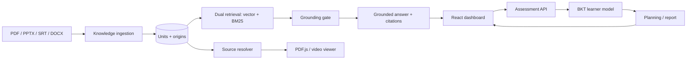

# ECV-Tutor architecture

## System overview

ECV-Tutor is an offline-first adaptive tutoring system. Course material is ingested into a small persistent tutor store and a dual-index retrieval layer. The FastAPI service exposes grounded chat, assessment, learner-model, planning, and citation APIs; the React dashboard consumes those APIs through the Vite `/tutor` proxy.

## Module responsibilities

| Module | Responsibility |
| --- | --- |
| `knowledge` | Parse documents, preserve text and multimodal origins, assign topics, and write units. |
| `rag` | Maintain retrieval indexes and merge vector/BM25 results. |
| `grounding` | Apply lexical relevance/refusal gates, assemble evidence, and emit structured citations. |
| `learner` | Maintain per-topic BKT state (`pL0`, `pT`, `pG`, `pS`) and mastery summaries. |
| `assessment` | Generate public-safe quiz questions, grade answers, and create diagnostic reports. |
| `planning` | Topologically order the course graph and produce study activities/flashcards. |
| `citations` | Resolve a unit origin to a real local file, page/slide, or video timestamp. |
| `web` | Provide chat, quiz, report, plan, and three-step diagnostic workflows. |

## Request/data flow

1. `seed_demo.py` or an ingestion endpoint parses bundled material.
2. Each unit stores text, `topic_ids`, `source_id`, and an `origin` object.
3. Chat retrieves evidence. The grounding gate refuses weakly supported queries before answer generation.
4. The UI renders citation labels. `/tutor/source/open` validates the unit and returns viewer metadata.
5. Quiz submission updates BKT state. Diagnostic finalization derives topic priors and stores a report.
6. Planning reads topic prerequisites and learner mastery to prioritize learning and review.

## Runtime boundaries

- `/tutor/files` serves only allow-listed demo/source paths; arbitrary filesystem paths are rejected.
- LLM, embedding, VLM, OCR, and RAGAS integrations are optional. Offline templates and BM25 keep the core demo runnable without credentials or GPU.
- CI runs tests and a frontend build; heavy RAGAS experiments are offline evaluation jobs, not CI gates.
